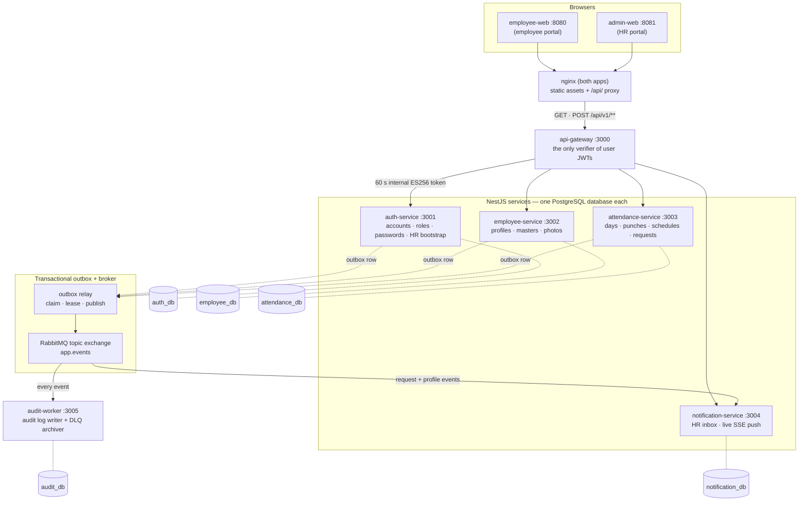
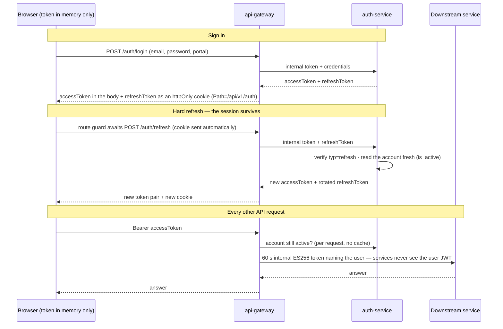
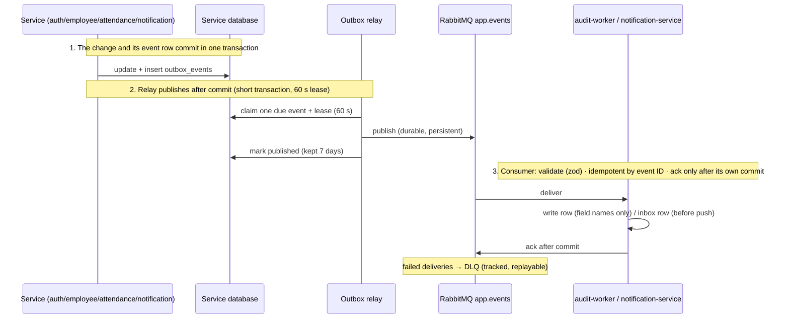

# Dexa employee attendance

WFH attendance and employee monitoring system: two React web apps (employee portal, HR portal)
over NestJS microservices, PostgreSQL per service, and RabbitMQ events.

## Quick start (one command)

Requires Node 24 (`nvm use`) and Docker. Then:

```bash
npm run setup
```

That single command:

1. creates `.env` with random local passwords and development token keys (never overwritten if it
   already exists),
2. installs dependencies if `node_modules` is missing,
3. builds and starts the whole stack with Docker Compose (first build takes a few minutes),
4. lets every service run its migrations and startup seeds (roles, master data, default work
   schedule), and
5. creates the HR admin account (bootstrap) and the employee test account below.

When it finishes, the stack is running and ready to test. Re-running it is safe: every step is
idempotent.

### Test accounts

Local-only credentials, seeded by `npm run setup`. Never use them in a deployed environment.

| Role     | Email                 | Password      | Sign in at            |
| -------- | --------------------- | ------------- | --------------------- |
| HR admin | `hr.admin@dexa.test`  | `HrAdmin123`  | http://127.0.0.1:8081 |
| Employee | `employee1@dexa.test` | `Employee123` | http://127.0.0.1:8080 |

The employee portal also accepts the HR account (PRD AUTH-3).

### URLs

| App                 | URL                          |
| ------------------- | ---------------------------- |
| Employee web        | http://127.0.0.1:8080        |
| Admin web (HR)      | http://127.0.0.1:8081        |
| API gateway         | http://127.0.0.1:3000/api/v1 |
| RabbitMQ management | http://127.0.0.1:15672       |

The web apps reach the gateway same-origin through the nginx `/api/` proxy, so no CORS setup is
needed.

### Audit database

The audit worker uses its own local PostgreSQL database. The password is generated into `.env` by
`npm run setup` and must not be committed or copied into documentation.

| Setting | Local value |
| ------- | ----------- |
| Host | `127.0.0.1` |
| Port | `5432` |
| Database | `audit_db` |
| User | `audit_app` |
| Password | The value of `AUDIT_DB_PASSWORD` in `.env` |
| Audit table | `audit_logs` |
| Failed-message table | `dlq_messages` |

To connect from the host without putting the password in the command history:

```bash
grep '^AUDIT_DB_PASSWORD=' .env

set -a
. ./.env
set +a
PGPASSWORD="$AUDIT_DB_PASSWORD" psql \
  --host 127.0.0.1 \
  --port 5432 \
  --username audit_app \
  --dbname audit_db
```

Example query:

```sql
SELECT event_id, event_type, account_id, actor_account_id, changed_fields, occurred_at
FROM audit_logs
ORDER BY occurred_at DESC
LIMIT 50;
```

### Swagger and Storybook

Run the browser documentation locally after the stack is running:

```bash
npm run docs
```

This opens:

| Document | URL |
| -------- | --- |
| Swagger UI | http://127.0.0.1:3000/docs |
| OpenAPI JSON | http://127.0.0.1:3000/docs-json |
| Storybook | http://127.0.0.1:6006 |

The script temporarily enables Swagger on the gateway and starts Storybook for `@dexa/ui`. Press
`Ctrl+C` to stop Storybook. The application containers remain running.

### RabbitMQ management

Open http://127.0.0.1:15672 and sign in with the broker account below. The username also owns and
declares every queue and exchange the topology code needs; the password is a fixed local-credentials
value like the test accounts (never use it in a deployed environment).

| Role             | Username | Password       |
| ---------------- | -------- | -------------- |
| RabbitMQ account | `dexa`   | `RabbitDev123` |

| Page               | What to look for                                                                                                                                                                                                     |
| ------------------ | -------------------------------------------------------------------------------------------------------------------------------------------------------------------------------------------------------------------- |
| Queues             | One durable queue per consumer (`audit.<purpose>`, `hr.notifications`), each a quorum queue with a delivery limit and its own dead-letter queue (`*.dlq`). A growing queue means its consumer is stopped or failing. |
| Message rates      | Steady small publish rates through the `app.events` exchange; silence with a nonzero outbox backlog means look at the relay's warnings in `docker compose logs <service>`.                                           |
| Dead-letter queues | Rows here mean a message failed `MAX_DELIVERIES` times; audit-covered ones appear in `audit_db.dlq_messages` for replay. Empty is the normal state.                                                                  |
| Connections        | One connection per running backend service. If a service restarts, its connection drops and comes back on its own.                                                                                                   |

Services connect with the same account — one user, so a queue the broker created stays owned by
`dexa` and survives container rebuilds.

### Stop, reset, reseed

```bash
docker compose --profile apps down                    # stop the stack (keeps data)
docker compose --profile apps down -v && rm .env      # wipe data and configuration
npm run setup                                         # fresh setup from scratch
npm run seed:dev                                      # re-create only the test accounts
```

`npm run seed:dev` waits for the running stack, then signs in as the HR admin and creates the
employee test account through the real provisioning flow. It is idempotent.

## Manual alternative

`npm run setup` is the supported path. Doing it by hand:

```bash
nvm use                  # Node 24
npm install
cp .env.example .env     # fill passwords, keys (npm run -s keys:generate), bootstrap values
npm run infra:up         # postgres + rabbitmq
docker compose --profile apps up -d --build
npm run seed:dev
```

## Layout

| Path                                                                                  | Purpose                                                   |
| ------------------------------------------------------------------------------------- | --------------------------------------------------------- |
| `apps/api-gateway`                                                                    | Public REST entry (port 3000)                             |
| `apps/auth-service`, `employee-service`, `attendance-service`, `notification-service` | Domain services (3001-3004), one database each            |
| `apps/audit-worker`                                                                   | Audit worker host (3005): audit log writer + DLQ archiver |
| `apps/employee-web`, `apps/admin-web`                                                 | React apps (8080, 8081) sharing `@dexa/ui`                |
| `libs/common`, `libs/db`, `libs/messaging`                                            | Backend-only shared code                                  |
| `packages/contracts`, `packages/ui`, `packages/api-client`, `packages/session`        | Shared by backend and frontend                            |
| `scripts/setup-dev.mjs`                                                               | The one-command setup behind `npm run setup`              |

Services never import each other. They share only `libs/*` and `packages/*`.

## Architecture

One REST API behind a gateway; five NestJS services, each owning its own PostgreSQL database; one
RabbitMQ event exchange. Full detail: `docs/ARCHITECTURE.md`. The diagrams below are Mermaid and
render directly on GitHub.

### Topology



### What each service owns — `DATABASE.md` is the authority

| Service              | Database          | Owns                                                                                                                              |
| -------------------- | ----------------- | --------------------------------------------------------------------------------------------------------------------------------- |
| auth-service         | `auth_db`         | Accounts, roles, credential verification, token issuance, HR bootstrap (advisory-locked)                                          |
| employee-service     | `employee_db`     | Employee profiles, positions/statuses, photos, provisioning state, bootstrap HR profile                                           |
| attendance-service   | `attendance_db`   | Attendance days, punches + classification, work schedules and calendar, overtime/correction requests, HR monitoring and summaries |
| notification-service | `notification_db` | HR notification inbox rows, read state, SSE subscribers                                                                           |
| audit-worker         | `audit_db`        | Audit log of every event (who/what/field names), DLQ tracking + archive/replay state                                              |

### Authentication and sessions



- Deactivation takes effect on the next request: `401 ACCOUNT_DISABLED`.
- One expired-token `401` is retried once after a silent refresh.
- Logout clears the cookie; the stateless refresh token itself just expires (no revocation table).

### Events (outbox pattern; `libs/messaging`)



- Quorum queues with delivery limits; redelivery is safe because consumers are idempotent.
- The web apps never talk to services directly: only gateway → service and service → service.

### Frontend (`packages/session`, D-56)

- TanStack Query is the only server-state store; the session (in-memory token, portal, roles) is a
  React Context above the router, whose guards `await` the one session-restore attempt per load.
- `@dexa/contracts` carries every zod schema; both apps share `@dexa/ui` and `@dexa/session`, so a
  screen differs only in portal, roles, copy, and routes.

## Commands

| Command                                  | Purpose                                       |
| ---------------------------------------- | --------------------------------------------- |
| `npm run setup`                          | One-command setup: .env, stack, seed          |
| `npm run seed:dev`                       | Seed the dev test accounts on a running stack |
| `npm run lint`                           | ESLint and Prettier check                     |
| `npm run typecheck`                      | Type-check every workspace                    |
| `npm test`                               | Unit tests (Jest backend, Vitest frontend)    |
| `npm run test:integration`               | Backend HTTP integration tests                |
| `npm run build`                          | Build everything                              |
| `npm run build:storybook`                | Build Storybook                               |
| `npm run dev -w @dexa/<name>`            | Run one workspace with reload                 |
| `npm run storybook`                      | Design system docs on :6006                   |
| `npm run db:generate -w @dexa/<service>` | Generate a Drizzle migration                  |
| `npm run db:migrate -w @dexa/<service>`  | Apply migrations                              |
